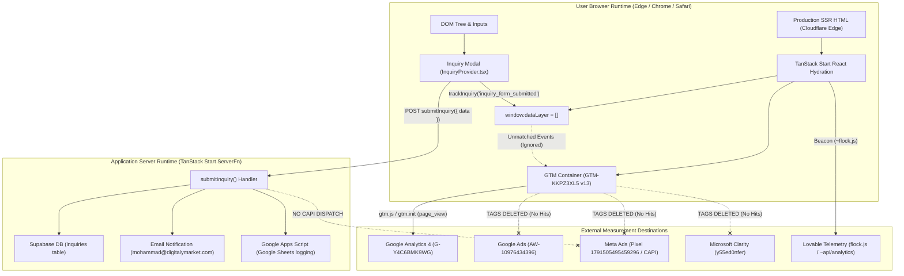
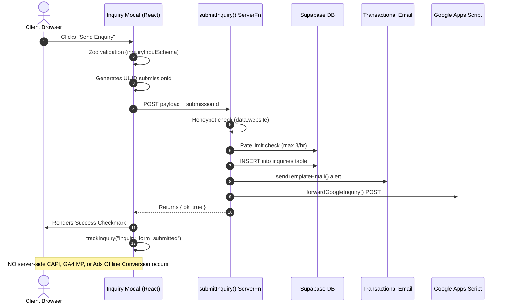

# Current Tracking Architecture — DigitalyMarket

**Audit Codename:** DYM-MEASUREMENT-FORENSICS  
**Document:** `01_Current_Tracking_Architecture.md`  
**Target:** `https://digitalymarket.com`  
**Evidence Links:** `EVD-01`, `EVD-02`, `EVD-03`, `EVD-04`, `EVD-05`, `EVD-06`, `EVD-07`, `EVD-11`  

---

## 1. System Topology & Application Stack



### 1.1 Technical Stack Characteristics
- **Core Framework:** TanStack Start (`tanstack_start_ts` v1.168.60) running on React 18, Vite 5, TypeScript.
- **Routing Engine:** `@tanstack/react-router` (v1.170.41) utilizing file-based routing with client-side history state management (`window.history.pushState` / `replaceState`).
- **Rendering Model:** Hybrid Server-Side Rendering (SSR) streaming with client-side hydration.
- **Hosting & CDN:** Cloudflare edge reverse-proxy terminating SSL, injecting security headers (`Strict-Transport-Security`, `X-Content-Type-Options: nosniff`), and caching static assets.
- **Backend Architecture:** TanStack Start Server Functions (`createServerFn({ method: "POST" })`) executing in a Node.js/Edge server environment.
- **Database & Storage:** Supabase PostgreSQL instance utilizing server-side service role client (`@supabase/supabase-js`).

---

## 2. Tracking Entry-Point Inventory

### 2.1 Head & Shell Injections (`src/routes/__root.tsx`)
1. **Google Tag Manager Loader:**
   ```html
   <script type="text/javascript">
   (function(w,d,s,l,i){w[l]=w[l]||[];w[l].push({'gtm.start':
   new Date().getTime(),event:'gtm.js'});var f=d.getElementsByTagName(s)[0],
   j=d.createElement(s),dl=l!='dataLayer'?'&l='+l:'';j.async=true;j.src=
   'https://www.googletagmanager.com/gtm.js?id='+i+dl;f.parentNode.insertBefore(j,f);
   })(window,document,'script','dataLayer','GTM-KKPZ3XL5');
   </script>
   ```
   - **Location:** Injected into `<head>` via `head()` meta/script options in `__root.tsx`.
   - **Timing:** Loads asynchronously immediately upon HTML parsing.

2. **Inline DataLayer & gtag Stub:**
   ```html
   <script>window.dataLayer = window.dataLayer || [];function gtag(){dataLayer.push(arguments);}gtag('js', new Date());</script>
   ```
   - **Location:** Injected into the initial DOM stream.
   - **Timing:** Executes synchronously before GTM container scripts evaluate.

3. **Fallback Noscript Frame:**
   - In `__root.tsx`, `RootShell` renders `<noscript><iframe src="https://www.googletagmanager.com/ns.html?id=GTM-KKPZ3XL5".../></noscript>`.
   - **Defect:** In the live production SSR HTML delivered to browsers (`EVD-03`), the `<noscript>` tag is omitted or stripped during Edge SSR rendering.

4. **Platform Telemetry:**
   - Script `<script defer src="/~flock.js" data-proxy-url="/~api/analytics"></script>`
   - Script `<script defer src="/__l5e/events.270c78a44fc53e7b.js"...></script>`
   - Dispatches user-agent, locale, and routing performance telemetry to Lovable infrastructure.

5. **Search Console Token:**
   - `<meta name="google-site-verification" content="EqZrtxdyQDmh6l_BsNxR0UcG4vSvrwSC1RTfYNEgfc8" />`
   - Verified active and correctly placed.

---

## 3. DataLayer Architecture & State Machine

The client application manages tracking telemetry through an internal helper:
`src/lib/inquiry/state.ts` -> `trackInquiry(event: string, params: Record<string, string | number>)`

```typescript
type DataLayerWindow = Window & { dataLayer?: Record<string, unknown>[] };

export function trackInquiry(event: string, params: Record<string, string | number> = {}) {
  if (typeof window === "undefined") return;
  const w = window as DataLayerWindow;
  w.dataLayer = w.dataLayer || [];
  w.dataLayer.push({ event, ...params });
}
```

### 3.1 Pushed Custom Events vs GTM Triggers

| Lifecycle Stage | Frontend Function Call | Emitted `dataLayer` Object | GTM v13 Trigger Match | Actual Platform Dispatch |
| :--- | :--- | :--- | :--- | :--- |
| **Inquiry Open** | `trackInquiry("inquiry_popup_open", ...)` | `{ event: "inquiry_popup_open", source_page, source_service }` | ❌ None | None |
| **Form Interaction**| `trackInquiry("inquiry_form_started", ...)`| `{ event: "inquiry_form_started", source_page, source_service }` | ❌ None | None |
| **Validation Fail** | (None — handled via React state) | (None) | ❌ None | None |
| **Form Submitted** | `trackInquiry("inquiry_form_submitted", ...)` | `{ event: "inquiry_form_submitted", source_page, source_service, selected_service }` | ❌ None | None |
| **Submission Fail** | `trackInquiry("inquiry_form_error", ...)` | `{ event: "inquiry_form_error", source_page, source_service }` | ❌ None | None |

### 3.2 Dead Code Analysis: Meta Pixel SPA Navigation Hook
In `src/routes/__root.tsx` (lines 154–164):
```typescript
useEffect(() => {
  let lastPath = typeof window !== "undefined" ? window.location.pathname : "";
  const unsubscribe = router.subscribe("onResolved", () => {
    const nextPath = window.location.pathname;
    if (nextPath === lastPath) return;
    lastPath = nextPath;
    const fbq = (window as unknown as { fbq?: (...args: unknown[]) => void }).fbq;
    if (typeof fbq === "function") fbq("track", "PageView");
  });
  return unsubscribe;
}, [router]);
```
- **Forensic Diagnosis:** The developer anticipated client-side SPA route tracking for Meta Pixel. However, because Meta Pixel base code is not present in `<head>` and was deleted from GTM Container v13, `window.fbq` is permanently `undefined`. The listener evaluates on every client-side navigation without any effect.

---

## 4. Single-Page Application (SPA) Route Navigation Behavior

Because TanStack Router operates via client-side DOM transitions, standard full-page reloads do not occur during user exploration across `/services`, `/industries`, `/work`, and `/insights`.

### 4.1 GA4 Enhanced Measurement History Listener
In GTM Container Version 13, GA4 Enhanced Measurement is deployed with `vtp_historyEvents: true` inside Tag ID 36 (`__ccd_em_page_view`). 
- **Mechanism:** Google Tag injects a wrapper around `window.history.pushState` and `window.history.replaceState`.
- **Runtime Observation (`EVD-07`):** When navigating from `/` to `/services`, GA4 detects the history state change and automatically dispatches a `page_view` request to `google-analytics.com/g/collect` with `dl=https%3A%2F%2Fdigitalymarket.com%2Fservices`.
- **Limitation:** While basic virtual pageviews are recorded, custom page parameters (such as `page_type`, `author`, `industry_vertical`, or `service_category`) are never passed because the application pushes no custom `virtual_page_view` or `page_view` dataLayer event.

---

## 5. Backend Server Architecture & Lead Ingestion

Lead ingestion is governed by `src/lib/inquiry/submit.functions.ts`. 



### 5.1 Trace Observations
1. **Idempotency:** A client-generated UUID (`crypto.randomUUID()`) is passed as `submissionId` to prevent duplicate database rows on network retries.
2. **Missing Attribution Data:** The server receives `sourcePage` and `sourceService`, but does **not** collect or store `gclid`, `gbraid`, `wbraid`, `fbclid`, or UTM parameters (`utm_source`, `utm_medium`, `utm_campaign`).
3. **No Downstream Telemetry:** Neither `submit.functions.ts` nor `google-apps-script.server.ts` transmits any signal to Meta CAPI, Google Ads Offline Conversion, or GA4 Measurement Protocol.
