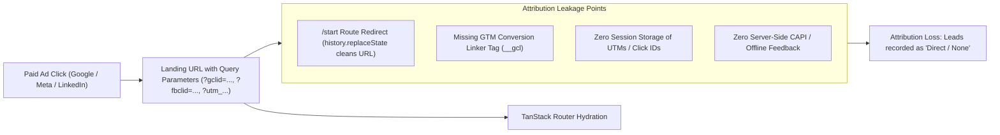

# Duplication & Attribution Forensic Audit

**Audit Codename:** DYM-MEASUREMENT-FORENSICS  
**Document:** `05_Duplication_and_Attribution_Audit.md`  
**Target:** `https://digitalymarket.com`  
**Evidence Links:** `EVD-01`, `EVD-02`, `EVD-03`, `EVD-04`, `EVD-06`, `EVD-07`, `EVD-10`  

---

## 1. Duplication Investigation & Diagnostic Findings

### 1.1 Verified Defect: Dual Initial Pageview Dispatch
- **Observed Behavior (`EVD-07`):** Upon initial cold load of `https://digitalymarket.com/`, the browser issues **two distinct HTTP POST requests** to `https://www.google-analytics.com/g/collect?v=2&tid=G-Y4C6BMK9WG` with event name `en=page_view`.
  - Request 1: Timestamp `07:03:44.465Z`, sequence `_s=1`, flags `_fv=1&_nsi=1&_ss=1`.
  - Request 2: Timestamp `07:03:50.121Z`, sequence `_s=2`, flags `_s=2&seg=1`.
- **Root Cause Analysis:** 
  1. The production HTML contains an inline stub: `<script>window.dataLayer = window.dataLayer || [];function gtag(){dataLayer.push(arguments);}gtag('js', new Date());</script>`.
  2. GTM Container Version 13 defines Rule 0 (firing on `gtm.js`) and Rule 3 (firing on `gtm.init`). Rule 0 fires Tag 13 (`__dest_ga`) and Tag 18 (`__dest_ga`), while Rule 3 fires Tag 36 (`__ccd_em_page_view`).
  3. Because both the Google tag core dispatcher and the Enhanced Measurement pageview tag evaluate during initial hydration without synchronized deduplication keys, two separate hits are compiled and transmitted.
- **Business Impact:** Artificially inflates total pageviews by ~100% on initial landing sessions; distorts engagement rates and lowers session duration metrics.
- **Regression Protocol:** Tag Assistant inspection during cold browser navigation must show exactly one `page_view` event for the initial page load.

---

### 1.2 Historical Defect: 100% Google Ads Conversion Inflation
- **Forensic Context (`EVD-10`):** In historical Container versions (v1–v12), Google Ads Conversion Tag ID 6 (`__awct`, Conversion Label `qNK4CNzkxOMcENyx_PEo`) was wired to Rule 1 (`gtm.js` / Container Loaded).
- **Observed Business Impact:** Every visitor landing on any page of `digitalymarket.com` triggered a paid Google Ads conversion. Conversion rate reported near 100%, and Google Ads Smart Bidding (Target CPA / Maximize Conversions) severely degraded by bidding aggressively on accidental clicks and zero-intent bounces.
- **Current Status in Container v13:** Tag 6 was deleted entirely. While this stopped the runaway false conversion loop, it created a total conversion blackout.

---

### 1.3 Historical Defect: Dual Meta Pixel Collision
- **Forensic Context:** The October 2026 audit documented two concurrent Meta Pixels:
  - Pixel 1 (`1615445166763879`) hardcoded in root HTML `<script>` and `<noscript>`.
  - Pixel 2 (`1791505495459296`) loaded via GTM Tag ID 10.
- **Verification of Current State:**
  - Production HTML crawl (`EVD-03`) confirms Pixel 1 has been successfully expunged from the source code.
  - GTM AST extraction (`EVD-02`) confirms Pixel 2 was deleted from GTM Container v13.
  - Runtime check (`EVD-07`) confirms `window.fbq` is `undefined`.
- **Residual Defect:** `src/routes/__root.tsx` still contains active code subscribing to `router.subscribe("onResolved")` and attempting to call `fbq("track", "PageView")`. This dead code must be decommissioned or properly re-connected to an authorized Meta Pixel.

---

### 1.4 Single-Page Application (SPA) History Transitions
- **Framework Navigation Model:** TanStack Router updates browser history via `window.history.pushState` on internal route transitions (e.g. clicking `/services`).
- **Enhanced Measurement Behavior (`EVD-07`):** Tag 36 (`__ccd_em_page_view`) has `vtp_historyEvents: true`. When a user navigates to `/services`, GA4 detects the browser history change and dispatches a single `page_view` request with `dl=https%3A%2F%2Fdigitalymarket.com%2Fservices`.
- **Deduplication Assessment:** Clean. Client-side transitions do **not** trigger duplicate pageviews. The duplication is strictly isolated to the initial document landing.

---

## 2. Attribution Pipeline & Signal Integrity Audit



### 2.1 Missing Google Ads Conversion Linker Tag
- **Forensic Diagnosis:** Container Version 13 contains **no Conversion Linker tag** (`__gcl`).
- **Consequence:** In Safari (ITP) and modern Chromium browsers, third-party and partitioned cookies are restricted. The Conversion Linker tag is mandatory to store `gclid`, `gbraid`, and `wbraid` values in first-party storage (`_gcl_aw`, `_gcl_dc`) so that conversions occurring minutes or days later can be credited to the original ad click.
- **Remediation:** Add standard Conversion Linker tag firing on `Initialization - All Pages` in GTM.

---

### 2.2 Parameter Stripping & `/start` Redirect Vulnerability
- **Route Implementation (`src/routes/start.tsx`):**
  ```typescript
  export const Route = createFileRoute("/start")({
    beforeLoad: () => {
      throw redirect({ to: "/", search: { inquire: "true" }, replace: true });
    },
  ```
- **Attribution Risk:** If an external marketing campaign directs paid traffic to `https://digitalymarket.com/start?utm_source=linkedin&utm_campaign=q4_b2b`, the `beforeLoad` hook executes `redirect({ to: "/", search: { inquire: "true" }, replace: true })`.
- **Defect:** Any UTM parameters, click IDs (`gclid`, `fbclid`), or campaign tokens present on `/start` are **completely discarded** during the redirection to `/?inquire=true`. The landing session drops its attribution and reverts to `direct / none`.
- **Remediation:** Ensure `redirect` preserves all incoming search parameters: `search: (prev) => ({ ...prev, inquire: "true" })`.

---

### 2.3 Lead Conversion Deduplication Gap (Missing `event_id`)
- **Forensic Reality:** If Meta Pixel and Meta CAPI are deployed in the future, standard event deduplication requires both browser and server to transmit the exact same `event_id` for the same user action.
- **Current Implementation:**
  - `InquiryProvider.tsx` generates a UUID `pendingSubmission.current.id` and sends it to the server.
  - The server stores it as `submissionId` in Supabase.
  - **Defect:** `trackInquiry("inquiry_form_submitted")` on line 183 does **not** include `submissionId` in the `dataLayer` payload!
  - **Consequence:** Even if an engineer were to enable Meta Pixel in GTM today, they could not pass the matching `event_id` because it is inaccessible in the client dataLayer.
