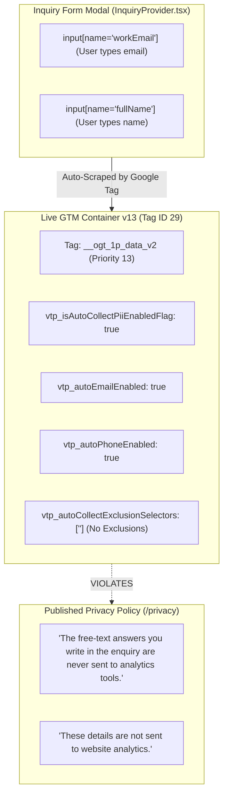

# Consent & Privacy Forensic Audit

**Audit Codename:** DYM-MEASUREMENT-FORENSICS  
**Document:** `06_Consent_and_Privacy_Audit.md`  
**Target:** `https://digitalymarket.com`  
**Evidence Links:** `EVD-01`, `EVD-02`, `EVD-03`, `EVD-05`, `EVD-06`, `EVD-07`, `EVD-08`, `EVD-09`  

---

## 1. Google Consent Mode v2 Forensic Signal Analysis

Under European Union Digital Markets Act (DMA) regulations and Google enforcement (effective March 2024), all websites transmitting user data to Google services must implement Google Consent Mode v2 with four mandatory parameter states:
1. `ad_storage`
2. `analytics_storage`
3. `ad_user_data`
4. `ad_personalization`

### 1.1 Verified Signal Telemetry from Live Production
Live CDP request capture (`EVD-07`) intercepted the actual telemetry header dispatched to Google Analytics 4:
```http
POST https://www.google-analytics.com/g/collect?v=2&tid=G-Y4C6BMK9WG&...&gcd=13l3l3l3l1l1&npa=0&dma=0&...
```

#### Forensic Decoding of the `gcd` Telemetry String
The Google Consent Decoder (`gcd`) parameter encodes the exact consent hierarchy in a compact syntax:
`gcd = 1 {ad_storage} {analytics_storage} {ad_user_data} {ad_personalization} 1 {source} 1`

In the observed production request: `gcd=13l3l3l3l1l1`:
- `1`: Format version 1.
- `3l`: `ad_storage` = Unset / Default not provided (`l`).
- `3l`: `analytics_storage` = Unset / Default not provided (`l`).
- `3l`: `ad_user_data` = Unset / Default not provided (`l`).
- `3l`: `ad_personalization` = Unset / Default not provided (`l`).
- `1l1`: Consent signal source = Not provided / Uninitialized.

Furthermore:
- `npa=0`: Non-Personalized Ads flag is set to `0` (meaning Personalized Advertising is **active by default** without user consent).
- `dma=0`: Digital Markets Act user consent is unmanaged.

### 1.2 Verdict on Consent Mode v2
**Status: COMPLETELY ABSENT & NON-COMPLIANT.**
There is no default consent configuration (`gtag('consent', 'default', {...})`), no Consent Management Platform (CMP), and no mechanism for visitors to grant, deny, or customize consent.

---

## 2. Privacy Policy Contradiction & First-Party Data Scraping



### 2.1 Direct Technical Evidence of DOM PII Scraping
In GTM Container Version 13 (`EVD-02`), Tag ID 29 is configured as follows:
```json
{
  "function": "__ogt_1p_data_v2",
  "priority": 13,
  "vtp_isAutoEnabled": true,
  "vtp_isManualEnabled": false,
  "vtp_autoPhoneEnabled": true,
  "vtp_autoCollectExclusionSelectors": [
    "list",
    [
      "map",
      "exclusionSelector",
      ""
    ]
  ],
  "vtp_isEnabled": true,
  "vtp_autoAddressEnabled": true,
  "vtp_autoEmailEnabled": true,
  "vtp_isAutoCollectPiiEnabledFlag": true,
  "tag_id": 29
}
```

### 2.2 Forensic Conflict Assessment
1. **The Technical Setting:** The Google Tag has automatic first-party data collection enabled (`vtp_isAutoCollectPiiEnabledFlag: true`, `vtp_autoEmailEnabled: true`). The exclusion list is empty (`exclusionSelector: ""`). When a user types their business email into the inquiry form modal, Google Tag automatically inspects DOM form fields and scrapes the email address.
2. **The Legal Promise:** On `https://digitalymarket.com/privacy` (`EVD-08`), Section 2 states:
   > *"Enquiries are stored securely and sent to our connected Google Sheet through Google Apps Script so we can manage and respond to them. **These details are not sent to website analytics.**"*
   And Section 5 states:
   > *"The free-text answers you write in the enquiry are never sent to analytics tools."*
3. **The Risk:** This creates a severe legal, regulatory (GDPR/FTC/DMA), and trust vulnerability. Google tags are scraping first-party lead data directly from the DOM while the website publicly promises it never transmits enquiry details to analytics tools.
4. **Remediation Requirement:**
   - Either explicitly configure `vtp_autoCollectExclusionSelectors` in GTM to exclude `#dm_inquiry_popup`, `.inquiry-modal`, and form inputs.
   - Or disable automated DOM scraping (`vtp_isAutoEnabled: false`) and rely strictly on manual, consented user-provided data variables for Google Ads Enhanced Conversions.

---

## 3. Cookie & Client-Side Storage Inspection

| Storage Mechanism | Key / Cookie Name | Purpose | Expiration | Security & Privacy Notes |
| :--- | :--- | :--- | :--- | :--- |
| **HTTP Cookie** | `__cf_bm` | Cloudflare bot management and rate limiting | 30 minutes | `HttpOnly; SameSite=None; Secure`. Essential security cookie. |
| **HTTP Cookie** | `_ga` | GA4 client identification | 2 years (default) | First-party client identifier. Set without consent gating. |
| **HTTP Cookie** | `_ga_Y4C6BMK9WG` | GA4 session state identifier | 2 years (default) | First-party session cookie. Set without consent gating. |
| **SessionStorage** | `dm_inquiry_popup_draft_v2` | Draft retention of enquiry form answers | Browser session | Preserves user draft during navigation; cleared on successful submission. Does not leak externally. |
| **LocalStorage** | None | N/A | N/A | No persistent first-party tracking tokens in localStorage. |

---

## 4. Server-Side Data Governance & Supabase Pipeline

In `src/lib/inquiry/submit.functions.ts` (`EVD-06`):
```typescript
const { error } = await supabaseAdmin.from("inquiries").insert({
  id: inquiryId,
  full_name: data.fullName,
  work_email: data.workEmail,
  company_name: data.companyName,
  country: "",
  selected_service: data.selectedService,
  additional_context: data.businessAndChallenge || null,
  source_service: data.sourceService || null,
  source_page: sanitizedSourcePage,
  consent: true,
});
```

### 4.1 Forensic Finding: Hardcoded Consent Field
- The database schema requires a `consent` boolean column in `inquiries`.
- In `submit.functions.ts`, the backend hardcodes `consent: true` on every insertion regardless of whether the user was presented with or checked an explicit consent checkbox.
- While the form UI displays: *"By submitting, you agree to our Privacy Policy"*, recording an unconditioned `consent: true` in the database without an explicit checkbox timestamp or version record limits compliance defense under GDPR audit standards.
