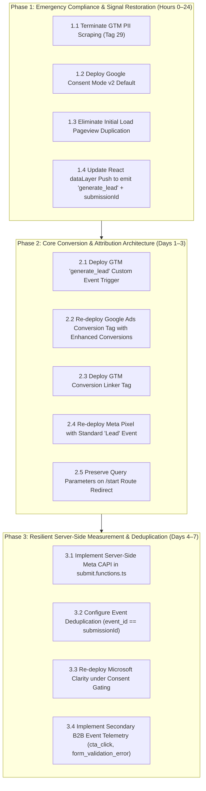

# Prioritized Remediation Roadmap & Implementation Guide

**Audit Codename:** DYM-MEASUREMENT-FORENSICS  
**Document:** `10_Prioritized_Remediation_Roadmap.md`  
**Target:** `https://digitalymarket.com`  
**Execution Standard:** Zero Production Disruption / Strict Dependency Hierarchy  
**Date:** 02 November 2026  

---

## 1. Remediation Hierarchy & Phasing Overview



---

## 2. Phase 1: Emergency Compliance & Signal Restoration (Hours 0–24)

### Action 1.1: Terminate GTM Automatic PII Scraping (Severity: Critical)
- **Problem:** Tag ID 29 (`__ogt_1p_data_v2`) is actively scraping email and phone values from DOM inputs, directly violating DigitalyMarket’s published Privacy Policy.
- **Remediation Steps:**
  1. In GTM Container `GTM-KKPZ3XL5`, edit Tag ID 29.
  2. Set `vtp_isAutoEnabled` to `false` and `vtp_isAutoCollectPiiEnabledFlag` to `false`.
  3. Alternatively, if Enhanced Conversions is desired via code, add exclusion selectors for `#dm_inquiry_popup`, `.inquiry-modal`, and `input[name="workEmail"]`.
- **Dependencies:** None.
- **Acceptance Criteria:** Inspect DOM input during inquiry form completion; verify no network calls to Google containing cleartext user data or unhashed DOM strings.
- **Rollback:** Revert GTM container to Version 13.

### Action 1.2: Deploy Google Consent Mode v2 Default (Severity: High)
- **Problem:** Absence of Consent Mode v2 (`gcd=13l3l3l3l1l1`) violates Google DMA mandate and GDPR standards.
- **Remediation Steps:**
  1. In `src/routes/__root.tsx`, inject Consent Mode v2 default configuration **above the GTM container loader**:
     ```html
     <script>
       window.dataLayer = window.dataLayer || [];
       function gtag(){dataLayer.push(arguments);}
       gtag('consent', 'default', {
         'ad_storage': 'denied',
         'analytics_storage': 'denied',
         'ad_user_data': 'denied',
         'ad_personalization': 'denied',
         'wait_for_update': 500
       });
     </script>
     ```
  2. Integrate a certified Google CMP (e.g., Cookiebot or OneTrust) to update consent state on user selection.
- **Dependencies:** None.
- **Acceptance Criteria:** Cold load in EU/UK proxy shows GA4 network payload containing `gcd=11p1p1p1p1` (denied) until user accepts banner, updating to `gcd=11t1t1t1t1` (granted).

### Action 1.3: Eliminate Initial Load Pageview Duplication (Severity: Medium)
- **Problem:** Dual `page_view` hits sent to GA4 on cold homepage load (`_s=1` and `_s=2`).
- **Remediation Steps:**
  1. Remove redundant inline `gtag('js', new Date());` snippet from HTML if GTM handles Google Tag configuration.
  2. In GTM, ensure Tag ID 13 (`__dest_ga`) has `vtp_ignoreDupeGtagConfigCalls: true` and remove duplicate tag instance (Tag 18).
- **Dependencies:** Action 1.2.
- **Acceptance Criteria:** Cold homepage load issues exactly one `page_view` hit to `google-analytics.com/g/collect`.

### Action 1.4: Update React DataLayer Push to Standard Event Taxonomy (Severity: Critical)
- **Problem:** `InquiryProvider.tsx` pushes `inquiry_form_submitted` without standard event naming or lead identifier.
- **Remediation Steps:**
  1. In `src/components/inquiry/InquiryProvider.tsx` (line 183), update the success callback:
     ```typescript
     trackInquiry("generate_lead", {
       lead_id: pendingSubmission.current?.id || "",
       event_id: pendingSubmission.current?.id || "",
       source_page: sanitizedSourcePage,
       source_service: parsed.data.sourceService || "general",
       selected_service: parsed.data.selectedService,
       currency: "USD",
       value: 0
     });
     ```
  2. Expose hashed email (`user_data.email`) in a separate dataLayer push if Google Ads Enhanced Conversions for Web is activated.
- **Dependencies:** None.
- **Acceptance Criteria:** Completing a test submission pushes `{ event: "generate_lead", lead_id: "...", event_id: "..." }` to `window.dataLayer`.

---

## 3. Phase 2: Core Conversion & Attribution Architecture (Days 1–3)

### Action 2.1: Build GTM `generate_lead` Custom Event Trigger (Severity: Critical)
- **Remediation Steps:**
  1. In GTM, create a Trigger:
     - Type: Custom Event
     - Event name: `generate_lead`
     - Firing condition: All Custom Events
  2. Create Data Layer Variables:
     - `dlv - event_id` -> Data Layer Key: `event_id`
     - `dlv - lead_id` -> Data Layer Key: `lead_id`
     - `dlv - selected_service` -> Data Layer Key: `selected_service`
- **Dependencies:** Action 1.4.
- **Acceptance Criteria:** Trigger activates in GTM Preview mode upon successful form submission.

### Action 2.2: Re-deploy Google Ads Conversion Tag with Enhanced Conversions (Severity: Critical)
- **Remediation Steps:**
  1. In GTM, create a Tag:
     - Type: Google Ads Conversion Tracking (`__awct`)
     - Conversion ID: `10976434396`
     - Conversion Label: `qNK4CNzkxOMcENyx_PEo`
     - Trigger: Custom Event `generate_lead` (ONLY!)
  2. Enable User-Provided Data (`user_data`) mapping for Enhanced Conversions.
  3. Ensure this tag **NEVER** fires on `gtm.js` or `All Pages`.
- **Dependencies:** Action 2.1.
- **Acceptance Criteria:** Conversion tag fires strictly upon valid form submission; zero requests to `googleadservices.com` on page navigation.

### Action 2.3: Deploy GTM Conversion Linker Tag (Severity: High)
- **Remediation Steps:**
  1. In GTM, create a Tag:
     - Type: Conversion Linker (`__gcl`)
     - Trigger: `Initialization - All Pages` (`gtm.init`)
     - Settings: Enable linking across all page URLs.
- **Dependencies:** None.
- **Acceptance Criteria:** Visiting `digitalymarket.com/?gclid=test_click_id` sets first-party cookie `_gcl_aw` containing `test_click_id`.

### Action 2.4: Re-deploy Meta Pixel with Standard `Lead` Event (Severity: High)
- **Remediation Steps:**
  1. In GTM, deploy Meta Pixel Base Tag:
     - Pixel ID: `1791505495459296`
     - Trigger: `Initialization - All Pages`
     - Event: `fbq('track', 'PageView')`
  2. Deploy Meta Pixel Lead Tag:
     - Pixel ID: `1791505495459296`
     - Trigger: Custom Event `generate_lead`
     - Event: `fbq('track', 'Lead', { content_category: {{dlv - selected_service}} }, { eventID: {{dlv - event_id}} })`
- **Dependencies:** Action 2.1.
- **Acceptance Criteria:** Meta Pixel Helper detects active Pixel `1791505495459296`; `Lead` event fires with `eventID` upon submission.

### Action 2.5: Preserve Query Parameters on `/start` Route Redirect (Severity: Medium)
- **Remediation Steps:**
  1. In `src/routes/start.tsx`, modify `beforeLoad`:
     ```typescript
     beforeLoad: ({ search }) => {
       throw redirect({
         to: "/",
         search: { ...search, inquire: "true" },
         replace: true,
       });
     },
     ```
- **Dependencies:** None.
- **Acceptance Criteria:** Navigating to `/start?utm_source=test&gclid=123` preserves `utm_source=test` and `gclid=123` on `/`.

---

## 4. Phase 3: Resilient Server-Side Measurement & Deduplication (Days 4–7)

### Action 3.1: Implement Server-Side Meta CAPI in `submit.functions.ts` (Severity: High)
- **Remediation Steps:**
  1. In `src/lib/inquiry/submit.functions.ts`, add a dedicated helper `sendMetaCapiLead()` called after Supabase insert confirms delivery.
  2. Payload structure:
     - `event_name`: `"Lead"`
     - `event_time`: Current Unix epoch timestamp
     - `event_id`: `inquiryId` (`submissionId`)
     - `action_source`: `"website"`
     - `event_source_url`: `data.sourcePage`
     - `user_data`: SHA-256 hashed email (`em`), client IP, and user-agent.
  3. Send POST request to `https://graph.facebook.com/v20.0/1791505495459296/events?access_token=${META_CAPI_ACCESS_TOKEN}`.
- **Dependencies:** Action 1.4, Action 2.4.
- **Acceptance Criteria:** Meta Events Manager receives server lead event matching browser lead event with identical `event_id`. Deduplication rate reports 100%.

### Action 3.2: Re-deploy Microsoft Clarity under Consent Gating (Severity: Low)
- **Remediation Steps:**
  1. In GTM, re-add Microsoft Clarity community template (`y55ed0nfer`).
  2. Assign Trigger: `Consent Initialization` or `Custom Event: consent_analytics_granted`.
  3. Configure sensitive input masking to ensure form answers and email fields are never recorded in session playbacks.
- **Dependencies:** Action 1.2.
- **Acceptance Criteria:** Clarity session recordings execute only after user grants consent; all inquiry input fields render masked as `*****`.
