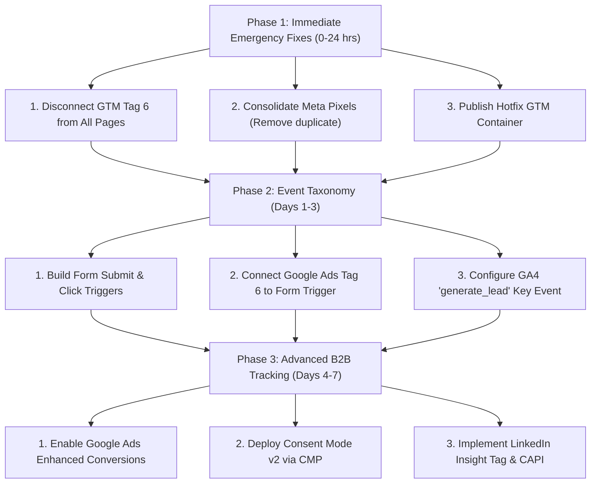

# Website Tracking & MarTech Stack Audit Report
**Target Property:** [digitalymarket.com](https://digitalymarket.com)  
**Inspection Date:** October 2026  
**Audit Scope:** Live Production DOM, Remote Google Tag Manager Container (`GTM-KKPZ3XL5`), GA4, Meta Pixels, Google Ads Conversion/Remarketing Tags, Microsoft Clarity, Search Console Tokens, Platform Telemetry.  
**Document Format:** Word Document available at `docs/DigitalyMarket_Tracking_Audit_Report.docx`

---

## Executive Summary & Scorecard

| Metric | Evaluation | Impact Level |
| :--- | :--- | :--- |
| **Overall Health Score** | **58 / 100** | Critical Attention Required |
| **Detected Tracking Systems** | **6 Platforms (7 Active Tags/IDs)** | Core telemetry functioning |
| **Conversion Integrity** | **🚨 Compromised (100% Pageview Conversion)** | Severe Ad Budget & Bidding Degradation |
| **Pixel Redundancy** | **⚠️ Dual Meta Pixels Across Two Ad Accounts** | Split Pixel Optimization & Event Inflation |
| **Custom Event Taxonomy** | **❌ Absent (No Lead / Contact Events in GTM)** | Zero Funnel Measurement |
| **Regulatory & Modern Tracking** | **❌ Missing Consent Mode v2 & Server-side CAPI** | Signal Loss on iOS/Safari & DMA Non-compliance |

---

## 1. Inventory of Active Tracking Systems

| Platform / Tool | Identifier / Tracking ID | Deployment Method | Firing Trigger | Operational Status |
| :--- | :--- | :--- | :--- | :--- |
| **Google Tag Manager** | `GTM-KKPZ3XL5` | Inline `<head>` script + `<body>` `<noscript>` iframe | All Pages | **Active & Healthy** |
| **Google Search Console** | `EqZrtxdyQDmh6l_BsNxR0UcG4vSvrwSC1RTfYNEgfc8` | `<meta name="google-site-verification">` | Head Meta Tag | **Active & Verified** |
| **Google Analytics 4 (GA4)** | `G-Y4C6BMK9WG` | GTM Tag ID `7` (`__googtag`) | `gtm.init` (Page Initialization) | **Active (Basic Only)** |
| **Meta (Facebook) Pixel #1** | `1615445166763879` | ~~Hardcoded in root HTML `<script>` & `<noscript>`~~ | Removed from code | **REMOVED / DECOMMISSIONED** |
| **Meta (Facebook) Pixel #2** | `1791505495459296` | GTM Tag ID `10` (Custom HTML) | `gtm.init` (All Pages) | **Active (Sole Authorized Pixel)** |
| **Google Ads Remarketing** | `AW-10976434396` | GTM Tag ID `5` (`__sp`) | `gtm.init` (All Pages) | **Active** |
| **Google Ads Conversion** | ID: `10976434396` Label: `qNK4CNzkxOMcENyx_PEo` | GTM Tag ID `6` (`__awct`) | `gtm.js` (Container Loaded / All Pages) | **🚨 CRITICAL ERROR** |
| **Microsoft Clarity** | `y55ed0nfer` | GTM Tag ID `12` (Clarity Template) | `gtm.js` (All Pages) | **Active & Recording** |
| **Platform Telemetry** | `lovp_4swew6k42c95qt154f8ja9g4g8` | Lovable / Flock (`~flock.js`, `/__l5e/events.*.js`) | Script Injection | **Active (Infrastructure)** |

---

## 2. Technical Deep Dive & System Analysis

### 2.1 Google Tag Manager (`GTM-KKPZ3XL5`)
* **Placement:** The container loader is placed high in `<head>` and the `<noscript>` fallback iframe is placed directly following the opening `<body>` tag.
* **Payload Health:** Remote container at `https://www.googletagmanager.com/gtm.js?id=GTM-KKPZ3XL5` returns HTTP 200 without syntax errors.
* **Architecture Gaps:**
  * Only default triggers are in use (`gtm.init` and `gtm.js`).
  * No custom dataLayer event triggers, click triggers, or element visibility triggers exist.
  * Enhanced Conversions is disabled (`enable_enhanced_conversions: "false"`).

### 2.2 Google Analytics 4 (`G-Y4C6BMK9WG`)
* **Configuration:** Deployed via the modern Google Tag (`__googtag`) under Tag ID 7.
* **Strengths:** Captures standard lifecycle events (page views, session start, first visit, and automatic enhanced measurement if enabled in GA4 admin).
* **Limitations:**
  * No custom conversion events are passed (`generate_lead`, `click_to_call`, `click_whatsapp`, `book_consultation`).
  * Lead acquisition ROI and channel attribution cannot currently be calculated in GA4.

### 2.3 Meta (Facebook) Pixel Dual Installation Conflict
* **Pixel #1 (Hardcoded):** ID `1615445166763879` initializes directly in `index.html` and fires `fbq('track', 'PageView')`.
* **Pixel #2 (GTM):** ID `1791505495459296` initializes inside GTM Tag ID 10 and fires `fbq('track', 'PageView')` on `gtm.init`.
* **Root Issues:**
  * Two separate Meta Ad Accounts are receiving data.
  * Browser sends duplicate PageView events on every navigation.
  * Retargeting audiences and lookalikes are split between accounts.
  * No Meta Conversions API (CAPI) is integrated.

### 2.4 Google Ads Conversion Tracking (🚨 Critical Severity)
* **Tag Details:** GTM Tag ID `6` (`__awct`), Conversion ID `10976434396`, Label `qNK4CNzkxOMcENyx_PEo`.
* **Firing Condition:** Triggered by Rule 1 (`gtm.js`), which executes on **every standard pageview across the entire website**.
* **Impact Analysis:**
  * Every visitor who lands on the home page or any subpage triggers a paid ad conversion.
  * Google Ads Smart Bidding (Target CPA / Maximize Conversions) optimizes toward low-intent, accidental clicks and bots that bounce immediately.
  * Conversion rate reports artificially show near 100%, masking true lead volume.

### 2.5 Microsoft Clarity (`y55ed0nfer`)
* **Deployment:** Cleanly integrated via GTM Community Template Tag ID 12.
* **Status:** Capturing heatmaps, dead clicks, rage clicks, and session recordings.
* **Optimization:** Ensure GA4 integration toggle is activated inside the Clarity dashboard.

---

## 3. Strategic MarTech Recommendations (B2B Agency Focus)

To support DigitalyMarket's positioning as a premium B2B Digital Marketing and Generative Engine Optimization (GEO) agency, the following integrations are prioritized:

### Priority 1: Google Consent Mode v2 (DMA Compliance)
* **Rationale:** Required for Google Ads and GA4 under the EU Digital Markets Act.
* **Benefit:** Recovers up to 65% of lost conversion data through Google AI modeled conversions when cookies are declined.

### Priority 2: Meta Conversions API (CAPI)
* **Rationale:** Bypasses iOS Safari ITP, Firefox tracking protection, and browser ad-blockers.
* **Benefit:** Direct server-to-server lead event transmission with deduplication increases event match quality (EMQ) and lowers CPA.

### Priority 3: LinkedIn Insight Tag & Conversions API
* **Rationale:** Essential for high-ticket B2B client acquisition (industrial manufacturers, corporate clients, tech firms).
* **Benefit:** Unlocks job title, seniority, company size, and industry analytics for all website visitors; enables account-based retargeting.

### Priority 4: Google Ads Enhanced Conversions for Leads
* **Rationale:** SHA-256 hashed first-party user data (email and phone number) passed upon form submission.
* **Benefit:** Improves conversion match rates across Google Search, Performance Max, and YouTube campaigns.

### Priority 5: B2B Visitor Deanonymization (e.g., Factors.ai / Albacross / Snitcher)
* **Rationale:** Only 2-3% of B2B website visitors complete a contact form.
* **Benefit:** Reverse-IP lookup reveals the company names and industries of visiting organizations, feeding warm accounts directly to outbound sales.

### Priority 6: Microsoft Advertising (Bing UET) Tag
* **Rationale:** Enterprise desktop users frequently operate on Windows and Edge with Bing as the default search engine.
* **Benefit:** Captures low-competition, high-intent B2B search traffic.

---

## 4. Standardized Event Tracking Taxonomy

| Event Name | Trigger Condition | Parameters | Destination Tags |
| :--- | :--- | :--- | :--- |
| `generate_lead` | Contact form submission success | `form_id`, `service_interest`, `lead_type` | GA4 (Key Event), Google Ads (Primary), Meta (Lead), LinkedIn |
| `click_whatsapp` | Click on WhatsApp link / floating icon | `link_url`, `page_location`, `button_location` | GA4 (Key Event), Meta (Contact), Google Ads (Secondary) |
| `click_to_call` | Click on telephone links (`tel:`) | `phone_number`, `page_location` | GA4, Google Ads Call Conversion |
| `book_consultation`| Meeting booking confirmation | `meeting_type`, `appointment_date` | GA4 (Key Event), Google Ads, Meta (Schedule) |
| `download_case_study`| Case study or whitepaper download | `file_name`, `file_extension`, `asset_topic` | GA4, Meta (ViewContent) |
| `scroll_deep` | 75% and 90% scroll depth | `depth_threshold`, `page_title` | GA4 (Engagement) |

---

## 5. Phased Remediation Plan

### Phase 1: Immediate Emergency Hotfix (Hours 0–24)
1. **Unlink Tag ID 6:** In GTM, open Tag ID `6` (`__awct`) and remove the `All Pages` trigger immediately.
2. **Consolidate Meta Pixels:** Confirm the active Meta Ad Account. Remove the duplicate hardcoded pixel snippet from `index.html` or remove Tag ID `10` from GTM.
3. **Publish Emergency Version:** Deploy the updated GTM container to prevent ongoing data corruption in Google Ads.

### Phase 2: Core Conversion Tracking (Days 1–3)
1. **Create Custom Trigger:** Set up a GTM trigger for contact form submissions (via custom event `lead_submitted` or element visibility).
2. **Re-link Google Ads Tag ID 6:** Re-attach Tag ID 6 exclusively to this lead trigger.
3. **Deploy GA4 Lead Event:** Configure a GA4 event tag firing `generate_lead` on form success.
4. **Deploy WhatsApp & Call Triggers:** Configure link click triggers for phone and WhatsApp outreach.

### Phase 3: Advanced B2B Setup (Days 4–7)
1. **Enable Enhanced Conversions:** Configure user-provided data variables in GTM to pass hashed emails and phone numbers to Google Ads.
2. **Implement Consent Mode v2:** Deploy a certified Consent Management Platform (e.g., Cookiebot or OneTrust) to govern tag firing in compliance with European regulations.
3. **Add LinkedIn Insight Tag:** Deploy the tag via GTM Community Template for corporate audience intelligence.

---

## 6. QA & Verification Protocol

1. **Google Tag Assistant (`tagassistant.google.com`):**
   * Confirm Google Ads Conversion Tag does **not** fire on page navigation.
   * Confirm it fires strictly upon form completion.
2. **Meta Pixel Helper:**
   * Verify that only **one** Pixel ID is present.
   * Verify that only a single `PageView` is triggered per page.
3. **GA4 DebugView (`Admin > DebugView`):**
   * Inspect real-time stream for proper parameter ingestion on `generate_lead`, `click_whatsapp`, and `click_to_call`.
4. **Google Ads Conversion Status:**
   * Verify in Google Ads > Goals > Conversions that the conversion count aligns with actual form submissions within 24-48 hours.

---
*Report generated and archived for DigitalyMarket Leadership & Technical Marketing Team.*
